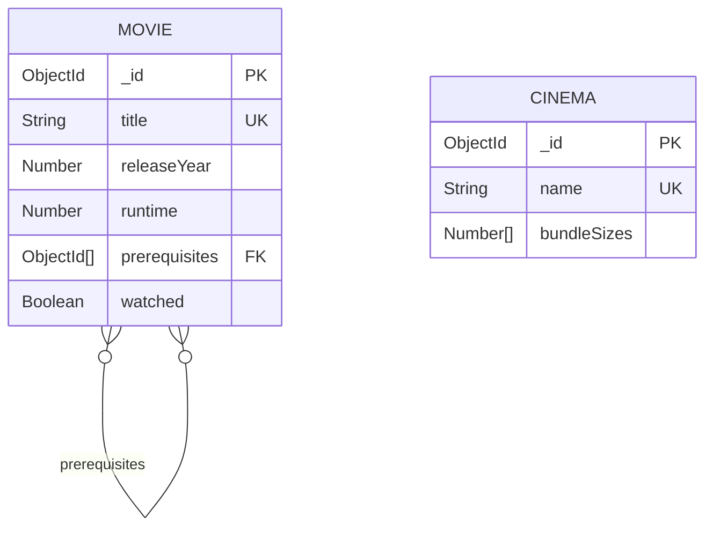

# Doomsday Ready

A full-stack MCU movie management and cinema booking application. Organize your Marvel Cinematic Universe movie collection, generate prerequisite-based rewatch plans, track your watching progress, and calculate optimal ticket bundle combinations for group bookings.

## Features

### 🎬 Movie Management
- Add and manage MCU movies.
- Update movie information and prerequisites.
- Track watched and unwatched movies.
- View movie collection statistics.
- Prevent duplicate movie titles and invalid movie dependencies.

### 🔄 MCU Rewatch Plan
- Select a target MCU movie.
- Automatically identify all direct and indirect prerequisite movies.
- Generate a chronological dependency-based watch order.
- Avoid duplicate movies in the generated plan.
- Track watched movies and rewatch progress.

### 🎟️ Cinema Management & Booking Calculator
- Create cinemas with custom ticket bundle sizes.
- View available cinemas and their bundle options.
- Enter a group size to calculate ticket requirements.
- Find an exact combination using the minimum number of bundles.
- Handle cases where an exact combination is not possible.

The booking calculator uses **Dynamic Programming** to find an optimal solution instead of relying on a simple greedy approach.

## Tech Stack

| Frontend | Backend | Database |
|---|---|---|
| React 19 | Node.js | MongoDB |
| TypeScript | Express.js | Mongoose |
| Vite | TypeScript | |
| React Router | | |
| Tailwind CSS | | |

## Data Model

The application uses two main MongoDB collections: `Movies` and `Cinemas`.



### Movie Model

| Field | Type | Description |
|---|---|---|
| `_id` | ObjectId | Unique movie identifier |
| `title` | String | Unique movie title |
| `releaseYear` | Number | Movie release year |
| `runtime` | Number | Runtime in minutes |
| `prerequisites` | ObjectId[] | References to prerequisite movies |
| `watched` | Boolean | Watching status (defaults to `false`) |

The `prerequisites` field references other documents in the same `Movies` collection. This creates a self-referencing relationship that supports dependency-based rewatch plans.

### Cinema Model

| Field | Type | Description |
|---|---|---|
| `_id` | ObjectId | Unique cinema identifier |
| `name` | String | Unique cinema name |
| `bundleSizes` | Number[] | Available ticket bundle sizes |

Each cinema has between 1 and 10 distinct bundle sizes. Every bundle size must be an integer between 1 and 500.

## Project Structure

```text
doomsday-ready/
├── client/
│   └── src/
│       ├── components/
│       │   ├── cinema/
│       │   ├── home/
│       │   ├── movies/
│       │   ├── rewatch/
│       │   └── shared/
│       ├── pages/
│       ├── services/
│       ├── types/
│       ├── App.tsx
│       └── main.tsx
│
├── server/
│   └── src/
│       ├── config/
│       ├── controllers/
│       ├── models/
│       ├── routes/
│       ├── services/
│       ├── app.ts
│       └── server.ts
│
├── package.json
└── README.md
```

## Getting Started

### Prerequisites

Make sure you have the following installed:

- Node.js
- npm
- MongoDB database (local or MongoDB Atlas)

### 1. Clone the Repository

```bash
git clone https://github.com/alfaazahmed7/doomsday-ready.git
cd doomsday-ready
```

### 2. Install Dependencies

Install the root, frontend, and backend dependencies:

```bash
npm install
cd client && npm install
cd ../server && npm install
cd ..
```

### 3. Configure Environment Variables

Create a `.env` file inside the `server` directory:

```env
PORT=8000
MONGO_URI=your_mongodb_connection_string
```

Create another `.env` file inside the `client` directory:

```env
VITE_API_URL=http://localhost:8000
```

Replace the MongoDB connection string with your own database connection string.

### 4. Run the Application

From the project root directory, run:

```bash
npm run dev
```

This starts both the frontend and backend development servers.

The frontend runs on Vite's default development port, and the backend runs on port `8000` unless configured otherwise.

## API Endpoints

All backend endpoints are prefixed with `/api`.

### Movie Endpoints

| Method | Endpoint | Description |
|---|---|---|
| POST | `/movies` | Create a movie |
| GET | `/movies` | Get all movies |
| PATCH | `/movies/:id` | Update a movie |
| GET | `/movies/:id/rewatch-order` | Generate prerequisite-based rewatch order |

### Cinema Endpoints

| Method | Endpoint | Description |
|---|---|---|
| POST | `/cinemas` | Create a cinema |
| GET | `/cinemas` | Get all cinemas |
| GET | `/cinemas/:id/booking?groupSize=6` | Calculate optimal ticket bundles |

## AI Tools Usage

AI tools were used as development assistance throughout this project.

- **Component Development:** Used AI assistance when writing frontend components and implementing UI functionality.
- **UI Design:** Used AI tools for design ideas, layout improvements, and visual styling.
- **Logic Understanding:** Used AI assistance to understand the cinema and watch-party booking requirements, particularly the ticket bundle calculation logic and how to find an optimal combination.

AI was used as a supporting tool for development and learning, rather than as a replacement for understanding the project's functionality.

---

**Doomsday Ready** — Get ready for the next MCU milestone!